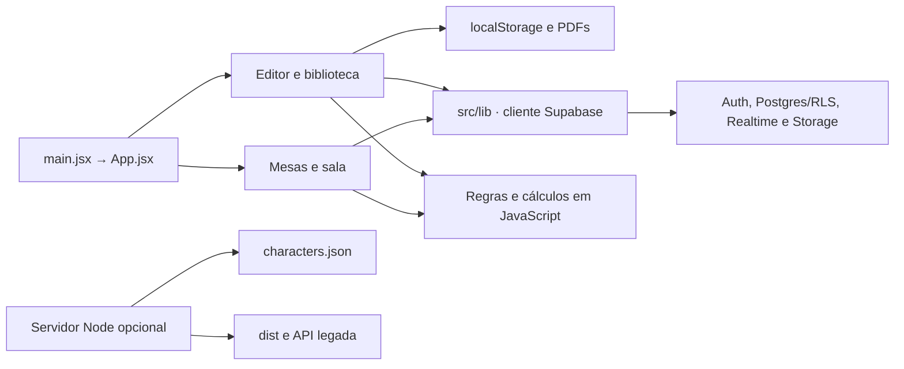

# Arquitetura — Crônicas de Manrakora

Referência do código no checkout `cbb0390`, revisado em 18/11/2026. A descrição do banco segue as migrações do repositório até a 0036. O schema remoto e os fluxos autenticados não foram verificados.

## Visão geral

O Elara Fichas reúne um editor de fichas de Savage Worlds adaptado à campanha, um leitor do livro e uma mesa virtual. É uma SPA React 19 com Vite 6. O frontend pode ser servido como arquivos estáticos. Com Supabase configurado, o próprio navegador usa Supabase Auth, Postgres, Realtime e Storage via `@supabase/supabase-js`.

As regras ficam em funções JavaScript reaproveitadas por telas diferentes. O estado de UI fica em componentes e hooks React. Os módulos de `src/lib/` encapsulam consultas, RPCs e acesso ao Storage. As migrações SQL definem permissões e operações que exigem validação ou transação no banco.

## Entrada e navegação

[index.html](../index.html) carrega [main.jsx](../src/main.jsx), que importa estilos e renderiza [App.jsx](../src/App.jsx). O [roteador](../src/lib/router.js) lê o hash, compatível com GitHub Pages. `loginThen` guarda o destino em `sessionStorage` para voltar após o login. `App` concentra autenticação, sessão de fichas, autosave, avisos e troca de página.

| URL | Entrada | Responsabilidade |
| --- | --- | --- |
| `#/` | `features/home/HomePage.jsx` | Página inicial e atalhos |
| `#/entrar` | `features/auth/AuthPage.jsx`, `useAuth.js` | Conta, sessão e perfil |
| `#/fichas` | `App.jsx`, `features/sheet/SheetModules.jsx` | Abas, biblioteca, editor, PDF e visão geral |
| `#/mesas` | `features/tables/TablesPage.jsx` | Mesas públicas e participações |
| `#/mesa/:id` | `features/tables/TablePage.jsx` | Detalhes, ingresso e administração |
| `#/convite/:code` | `features/tables/InvitePage.jsx` | Entrada por código |
| `#/sala/:id` | `features/room/RoomPage.jsx` | Sala virtual, tabuleiro, chat e ferramentas do mestre |

## Módulos

| Área | Arquivos de entrada | Onde procurar a regra ou integração |
| --- | --- | --- |
| Ficha | `App.jsx`, `SheetTabs.jsx`, `features/sheet/SheetModules.jsx` e componentes de cada seção | `rules.js` define o modelo, valores padrão, normalização e derivados. `sheets.js` gerencia sessões e abas. |
| Biblioteca e sincronização | `features/library/CloudSheets.jsx`, `useAutosave.js`, `syncCloud.js`, hooks de recebimento | `lib/cloud.js`, `sheetRebase.js`, `lib/{xp,money,rewards,engine,customItems,customSkills}.js` |
| PDF, livro e catálogos | `pdf.js`, `Book.jsx`, `Catalog.jsx`, `PowerCatalog.jsx`, `Templates.jsx`, `CustomArchetype.jsx` | `catalogRules.js`, `templates.js`, `races.json`, `archetypes.json`, `catalog.json`, `data/bookPowers.js`, `data/matchBookPower.js` |
| Inventário e perícias customizadas | `MarketTab.jsx`, `SkillsTab.jsx`, formulários de ficha e aprovações na sala | `market/` separa catálogo, inventário, efeitos e itens customizados. `skills/custom.js` concentra a normalização de perícias. `money.js` trata a moeda da campanha. |
| Mesas e permissões | `features/tables/`, `features/sheet/TableBinding.jsx` | `lib/tables.js`, `lib/cloud.js`, políticas e RPCs de associação e participação nas migrações |
| Sala e personagens | `RoomPage.jsx`, `useRoom.js`, `useLiveCharacters.js`, `PartyPanel.jsx`, `TableLog.jsx` | `lib/room.js`, `room/vitals.js`, `tokenState.js`, `incapacitation.js`, logs e estado no banco |
| Dados | `Dice.jsx` para expressões, `DicePanel.jsx` para a mesa, `DiceStage.jsx` para a animação | `dice.js`, `diceRoll.js`, `rpg/sheetRoll.js`, `rpg/edgeBonuses.js`, RPC `roll_dice` e `dice3d/` para geometria, malha e plano de animação com Three.js |
| Tabuleiro e tokens | `BoardView.jsx`, `useBoard.js`, `MasterModule.jsx`, `features/token/` | `lib/board.js`, `lib/tokens.js`, `lib/presets.js`, `creature.js`; criação de arte no navegador em `tokenArt.js` |
| Áudio | `AudioModal.jsx`, `MusicPlayer.jsx`, `SoundBar.jsx`, `useSoundpad.js` | `lib/music.js`, `lib/sounds.js`, `music.js`, `soundpad.js`, `defaultSounds.js`, `public/sounds/` |
| Rotinas e avanço | `TrainingModal.jsx`, `features/routine/`, aprovações de rotinas e pedidos | `training/` normaliza a agenda. `rpg/` contém relógio, prontidão, processamento, histórico, progressão, trabalho, estudo e aptidão. `lib/{clock,training,engine,requests,aptitude}.js` conecta ao banco. |
| UI comum | `src/ui/`, `style.css`, `theme.css` e CSS das features | Campos, diálogos, avisos, apresentação de moeda e identidade visual |

O leitor usa `public/assets/book.json` e páginas WebP em `public/assets/book/`. `scripts/extract-book.py` e `scripts/extract-templates.py` fazem parte do processamento offline dos dados do livro. Os assets distribuídos em `public/` seguem junto com o build. A visão geral da sala e a [visão local do mestre](../src/MasterView.jsx) têm pontos de entrada distintos.

## Dados e fontes de verdade

| Dado | Onde vive | Como é usado |
| --- | --- | --- |
| Conta e perfil | Supabase Auth e `profiles` | Identidade, sessão e nome apresentado |
| Sessão local de edição | `localStorage` em `manrakora-sheets-v1` | Abas, ficha ativa, rascunhos, vínculo e referência da revisão conhecida. `restoreSheets` também lê o formato antigo. |
| Ficha permanente | `characters.data` em JSON, com `schema_version`, `revision` e `table_id` na linha | Atributos, poderes, inventário, XP de campanha, dinheiro e imagem do token. O PDF exportado leva uma representação legível e dados para reimportação pelo app. |
| Participação | `tables`, `table_members` | Dono da mesa, status de participação e ficha selecionada em `table_members.character_id`. `characters.table_id` é o vínculo da ficha à mesa. |
| Estado da sessão | `table_character_state`, `table_state_log` | Valores correntes usados durante o jogo e registro de alterações. A ficha fornece os máximos calculados. |
| Comunicação e dados | `table_messages`, `table_rolls` | Chat e histórico de rolagens, com visibilidade tratada pelas regras do banco |
| Tabuleiro | `boards`, `board_tokens`, `board_marks`, `board_token_secrets`, `creature_presets` | Mapa, posições, marcas, presets e dados de criaturas. Nome e imagem ocultados ficam na tabela de segredos, com leitura do mestre. |
| Calendário e progresso | `table_training`, `table_clock`, `table_clock_log`, `table_routine_days`, `table_routine_runs`, `character_progress`, `character_training` | Rotinas reutilizáveis, atribuição por dia, relógio, processamento por hora e saldo de XP por alvo/modalidade |
| Solicitações e recompensas | `xp_awards`, `money_awards`, `evolution_awards`, `routine_requests`, `spell_*`, `aptitude_*` e tabelas de conteúdo customizado | Fluxos de concessão, aprovação, recebimento e histórico |
| Mídia | Buckets `maps`, `music` e `tokens`, além de `table_sounds` | Mapas e áudio têm URLs assinadas. O cliente gera URL pública para imagens do bucket de tokens. |

## Fluxos que cruzam módulos

### Editar, salvar e sincronizar fichas

1. O `App` restaura as abas, seleciona a ficha ativa, calcula derivados com `calculate` e passa dados e callbacks ao editor. Alterações atualizam a sessão e são persistidas no navegador.
2. Com conta, `useAutosave` espera cerca de um segundo após a alteração. Uma ficha nova é enviada após escolher a mesa. Se o usuário ainda não tem ficha selecionada na participação, o cliente tenta vinculá-la.
3. `lib/cloud.js` chama `validateCharacter` e atualiza a linha filtrando pelo `id` e pela `revision` conhecida. A sessão guarda a versão enviada como base para identificar edições feitas durante a requisição. Uma atualização sem linha retornada é tratada como conflito.
4. Desde a migração 0035, `grant_xp` e `grant_money` escrevem na própria ficha mesmo com o jogador offline. `useRewardSync` busca a nova versão e `sheetRebase.js` permite mesclar mudanças remotas restritas a XP e dinheiro com edições locais. Outros conflitos exigem sincronização. As rotas de claim continuam no código para os fluxos correspondentes. A 0036 aceita retirada de XP com piso zero.

Campos novos da ficha passam pelo contrato de `newCharacter` e `validateCharacter`, inclusive no carregamento do banco, rascunhos e importação de PDFs antigos. `calculate` centraliza derivados de campanha. XP geral determina nível e orçamento, estágios do catálogo têm faixas próprias e o motor de rotinas mantém saldos por alvo de treinamento.

### Abrir a sala e acompanhar mudanças

1. `RoomPage` compõe `useRoom`, `useBoard`, `useLiveCharacters`, `useClock` e hooks de aprovação. A participação e o dono da mesa orientam os controles apresentados. As permissões efetivas vivem em RLS, políticas de Storage/Realtime, funções SQL e gatilhos.
2. `useRoom` lê o estado inicial e abre o canal privado da mesa. Presence indica quem está online. Broadcast transporta eventos transitórios de arrasto e som e sinais de atualização. Postgres Changes acompanha linhas persistidas de chat, rolagens, membros e estado. O tabuleiro e o relógio também mantêm assinaturas próprias.
3. `useLiveCharacters` relê as fichas persistidas a cada cinco segundos com a página visível, ao voltar à aba e após certos eventos de recompensa. As assinaturas de Postgres Changes precisam de tabelas publicadas em `supabase_realtime`. Consulte o SQL ao ampliar um canal.
4. A rolagem da mesa chega pela RPC `roll_dice`. A UI monta a especificação e apresenta histórico e animação. Incapacitação tem representação em JavaScript e na lógica SQL da rolagem. Alterações em regras compartilhadas devem considerar as duas implementações.

### Aprovações e passagem de tempo

1. O jogador organiza uma rotina e atribui rotinas aos dias da ficha. O mestre pode aprovar rotinas e pedidos de trabalho/estudo. O calendário da campanha usa um tick por hora e o dia começa às 06:00.
2. [advance.js](../src/features/routine/advance.js) relê fichas, recursos, rotinas, calendário, progresso e pedidos. Verifica prontidão e usa [processor.js](../src/rpg/processor.js) para simular cada hora dos personagens vinculados. O mesmo domínio fornece simulação e apresentação do histórico.
3. O cliente envia eventos calculados e o tick esperado via `lib/engine.js` para `advance_time`. O banco valida o avanço, bloqueia a linha do relógio e registra horas processadas, recursos, progresso e relógio juntos. A implementação é introduzida pela 0024 e redefinida pela 0031, que estabelece piso de estamina durante a rotina.
4. Evolução, estudo de feitiço e aptidão têm fluxos próprios. Aptidão confirmada é cumulativa conforme a 0029. Para mexer em aprovação ou conclusão, siga a chamada da tela ao wrapper e à RPC mais recente antes de alterar o comportamento.

## Ambientes e código legado

- **Frontend local** — Node.js 22.12+, `npm install` e `npm run dev`. `npm run build` gera `dist/`, e `npm run preview` serve a compilação.
- **Supabase** — `VITE_SUPABASE_URL` e `VITE_SUPABASE_ANON_KEY` configuram o cliente em `src/lib/supabase.js`. Sem essas variáveis, o editor local funciona sem ativar os fluxos de nuvem. Em build configurado, `#/fichas` pede login. A configuração de frontend usa a chave publicável.
- **GitHub Pages** — [workflow](../.github/workflows/pages.yml) roda testes e build em push na `main` e quando acionado manualmente. Define `VITE_BASE` com o caminho do repositório e publica `dist/`.
- **Schema** — [guia de migrações](../supabase/migrations/README.md), os arquivos SQL e [CLAUDE.md](../CLAUDE.md) descrevem aplicação e dependências. O script `scripts/db.mjs` usa a Management API. Há sufixos distintos com o mesmo prefixo numérico e arquivos de rollback. Confira o nome completo e as dependências para cada mudança. O script não mantém histórico de migrações aplicadas.
- **Servidor legado** — `npm start` executa `server/index.js`, que serve `dist/` e `/api/characters`, usa chaves de edição e revisão e grava dados em `characters.json` no diretório configurado. O proxy do Vite e scripts em `deploy/` ainda existem. `ServerSheets.jsx` está no repositório sem import no frontend atual. A biblioteca ativa usa Supabase. As primeiras seções do README original descrevem o modo legado.
- **Testes** — `npm test` executa o runner do Node com lista explícita em `package.json`. Cobre regras, sessões, rebase, dados, mapa/token, inventário, rotinas e endpoints legados, entre outros. Para uma feature com SQL/RLS ou Realtime, a integração pode ser conferida com sessões de mestre e jogador em ambiente de teste.

## Onde começar ao implementar uma feature

| Quando a feature muda… | Primeiros pontos de entrada |
| --- | --- |
| Um campo de ficha ou cálculo | `rules.js`, aba correspondente, `sheets.js`, `pdf.js` e `lib/cloud.js` |
| Um dado corrente de combate ou sessão | `room/vitals.js`, `lib/room.js`, `useRoom.js`, regras de rolagem e migrações de estado |
| Quem pode agir ou visualizar algo na mesa | `features/tables/`, componente de sala, wrapper em `lib/` e políticas/RPCs que governam a operação |
| Posição, imagem ou condição de criatura | `BoardView.jsx`, `MasterModule.jsx`, `useBoard.js`, `lib/board.js`, `creature.js` e migrações de tokens |
| Recursos concedidos por um mestre | `PartyPanel.jsx`, wrappers de XP/dinheiro, migrações 0035–0036, `useRewardSync.js` e `sheetRebase.js` |
| Treino, calendário ou evolução | `TrainingModal.jsx`, `features/routine/`, `rpg/`, `training/`, wrappers de relógio/progresso e SQL da operação |

### Lacuna no histórico de migrações

`0018_custom_items.sql` está vazio neste checkout. O cliente usa `table_custom_items` e a 0021 já pressupõe que a tabela exista. Para recriar o banco do zero, confira a definição original dessa tabela e suas políticas antes de contar com a sequência de arquivos do repositório.
